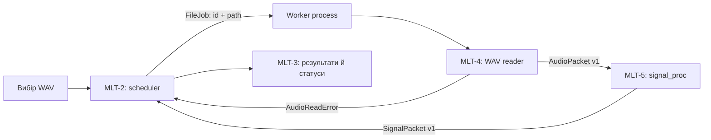

# Задум системи

## Призначення

Проєкт «Muliprocessing-Analisis» задуманий як локальна система для пакетного аналізу WAV-аудіо. Мета — декодувати файли, фільтрувати сигнали, обчислювати FFT і домінуючі частоти, паралельно обробляти кілька файлів та окремо показувати результати. Основні вимоги описані в Jira-плані та звіті PR1; цей репозиторій наразі містить реалізацію MLT-5, а не весь продукт.

## Поточний стан коду й окрема MLT-4 гілка — 2026-11-08

`origin/main` на `55ac0b2` містить MLT-5 і спільний `audio_contracts`, але не MLT-4. Окрема `origin/mlt-4-wav` на `94e9145` додає `src/audio_io/` з WAV reader, деталями формату та послідовною batch-функцією. Це review-кандидат, не частина `main` і не інтегрований продукт.

Reader повертає один `AudioPacket` або `AudioReadError` на файл і продовжує batch після помилки. `read_wav_batch` явно послідовний; паралельний scheduling лишається відповідальністю MLT-2. Jira MLT-27 прямо вимагає обробку кількох файлів паралельно, тож ця гілка сама по собі не виконує весь criterion.

## Межі модулів і рекомендований потік

1. **MLT-2 — оркестрація:** отримати список файлів, видати кожному стабільний `source_id`, обмежити кількість одночасних задач і розподілити їх між worker-ами.
2. **MLT-4 — аудіофайли:** worker читає один WAV, отримує sample rate і кадри; помилку читання перетворює на per-file error.
3. **MLT-5 — DSP:** отримати `AudioPacket`, за потреби застосувати фільтр, порахувати спектр і піки; повернути результат із тим самим `source_id`, не змінюючи вхід.
4. **MLT-2 — збір:** зіставити завершений `SignalPacket` або помилку із `source_id`, зафіксувати статус і передати результат у UI.
5. **MLT-3 — представлення:** окремо показувати для файла його параметри, статус/прогрес, спектр, піки та результат фільтрації.
6. **MLT-1 — тестування й оптимізація:** модульні й інтеграційні перевірки, заміри швидкодії, дефекти та регресія.

План Jira вимагає визначити межу процесів, але не фіксує її. Рекомендований вибір для наступної реалізації: parent надсилає в обмежену task queue лише невеликий `FileJob` (`source_id`, шлях, назва), а worker виконує MLT-4 → `AudioPacket` → MLT-5 локально. Так не треба pickle-ити повний decoded NumPy-масив при вході в worker. `FileJob` і worker orchestration ще не реалізовані; його точні поля слід оформити в `audio_contracts` разом із MLT-2.

Якщо конкретне середовище вимагає читати файл у parent-процесі, `AudioPacket` все одно є міжмодульним контрактом; тоді потрібно виміряти вартість передачі масиву. Не передавай необмежену кількість великих packet-ів через queue.

## Контракт MLT-4 → MLT-5

Спільні типи живуть у `src/audio_contracts/`; кожен модуль має власний пакет у `src/` (`src/signal_proc/` для MLT-5). Один WAV-файл — один `AudioPacket`, не один масив на весь batch.

`AudioPacket` версії 1 містить:

- `source_id`: стабільний і унікальний у межах запуску ідентифікатор для кореляції результату;
- `source_name`: необов’язкове ім’я файла для UI;
- `sample_rate_hz`: додатна частота дискретизації;
- `samples`: числовий C-contiguous NumPy-масив форми `(frames, channels)`. Моно приводиться до `(frames, 1)`; integer PCM залишається у вихідному масштабі, float — у своєму.

Кількість каналів, кадрів і тривалість виводяться з форми/частоти, щоб не дублювати суперечливі поля. MLT-5 один раз нормалізує integer PCM; `process_signal` приймає тільки валідний `AudioPacket` та повертає `SignalPacket` із тим самим `source_id`/`source_name`.

Для помилки декодування MLT-4 видає `AudioReadError` з `source_id`, кодом і коротким повідомленням. Це повідомлення обробляє оркестратор; його не передають у DSP. Так помилка одного WAV не перериває batch.

У рекомендованій схемі `AudioPacket` іде від MLT-4 до MLT-5 всередині worker-а, без queue. Якщо межа процесу проходить між цими модулями, передавай dataclass через `multiprocessing.Queue`, не пакуй масив у JSON/base64 і не змінюй `samples` після передачі. Queue серіалізує масив і може його копіювати; shared memory варто додавати лише після вимірювання цього вузького місця.

## Ключові вимоги з плану

- MLT-26/27: завантажити один/кілька WAV; помилка одного файла не повинна зупиняти інші.
- MLT-23/24/25: фільтрація, частотний спектр FFT, упорядковані домінуючі частоти; початковий файл не змінюється.
- MLT-21/22/19/20 і MLT-29: спроєктувати IPC, запуск worker-пулу, розподіл файлів і збір результатів. Аварія окремого процесу не має ламати решту обробки.
- MLT-16/17/18/28: прогрес/статус і результати для кожного файла.
- MLT-14/15/12/13: unit та integration тести, порівняння послідовного й паралельного режимів, виправлення та регресія.
- Межі за планом: WAV є цільовим форматом; мережевий розподілений режим і збереження нового аудіофайла не визначені як цілі.

## Тестування та критерії

Порівнювати послідовний і багатопроцесний режими на однакових файлах та умовах. Не припускати прискорення наперед: на малих файлах накладні витрати процесів можуть переважити виграш. Загальний поріг швидкодії та глобальний допуск числової похибки в плані не погоджені.

Звіт PR3 визначає для MLT-5 12 тест-кейсів і чек-лист із 18 перевірок: однотональний і двотональний сигнали, low/high-pass, незмінність входу, незалежні канали, uint8 PCM, тиша, частота між FFT-бінами, pickle/payload, межа Найквіста, NaN/нескінченність, порожній сигнал та некоректні параметри. Числові допуски в цьому звіті є локальними очікуваннями конкретних кейсів, а не загальною вимогою проєкту.

Тест-кейси PR3 викликають старий API `process_signal(samples, fs, source_id=...)`. Після введення `AudioPacket` їх потрібно адаптувати, обгорнувши дані пакетом; старий виклик не є поточним контрактом і його відмова не доводить дефект DSP.

Звіти PR2 і PR3 описують план/очікування, а не результати запуску. У тест-плані TP-MLT-2026-001 v1.1 задачі на скриншотах були `To Do`; фактичне виконання треба підтвердити окремо. Графік Sprint 1 (13.09–04.10.2026) — історичний план, не поточний статус.

## Непідтверджені дефекти

PR4 наводить кандидатів MLT-30–33: пошкоджений WAV перериває групове завантаження; порожній WAV обробляється некоректно; неточний пік FFT; неправильне сортування піків. У звіті прямо сказано, що їх не тестували й модулі ще не були реалізовані. Це сценарії для перевірки, не підтверджені дефекти.

## Джерела

- `Звіт_КПІ4_ПР1(1).docx` — структура Jira, епіки, історії користувачів і план Sprint 1.
- `Звіт_КПІ_Пр2(1).docx` — тест-план TP-MLT-2026-001, версія 1.1 від 04.10.2026.
- `КПІ4_ПР3_Лакей(1).docx` — тест-кейси й чек-лист MLT-5.
- `КПІ4_ПР4_Bugreport(1).docx` — неперевірені кандидати дефектів MLT-4/MLT-5.
